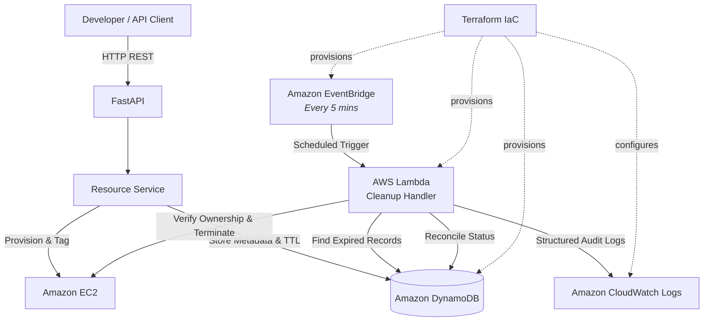
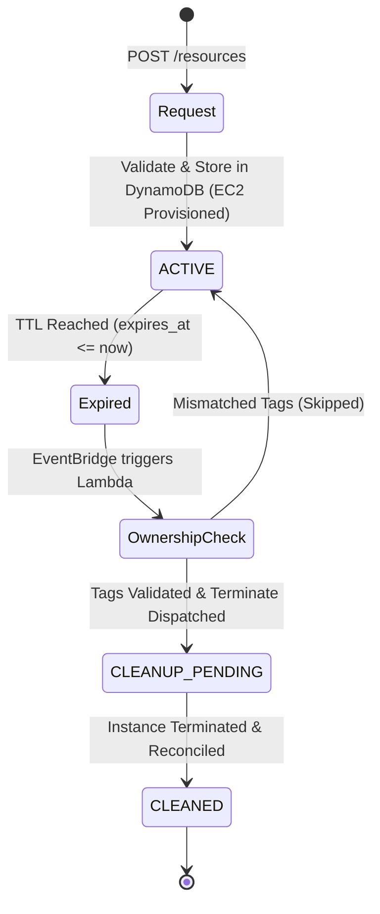

# ☁️ CloudExpire

<p align="center">
  <strong>Automated AWS Resource Lifecycle Management</strong><br>
  <em>Provision temporary AWS resources. Track their expiry. Clean them up automatically.</em>
</p>

<p align="center">
  <a href="https://github.com/TituJesh/CloudExpire/actions"></a>
  <a href="https://www.python.org/"></a>
  <a href="https://fastapi.tiangolo.com/"></a>
  <a href="https://aws.amazon.com/"></a>
  <a href="https://www.terraform.io/"></a>
  <a href="https://pytest.org/"></a>
</p>

---

## 📌 Overview

Temporary cloud environments frequently outlive their purpose, accumulating unnecessary cloud costs and security surface area. **CloudExpire** solves this by providing automated, TTL-driven lifecycle management for AWS resources.

Resources are provisioned through a FastAPI service with a defined time-to-live (TTL), tracked in Amazon DynamoDB, and continuously evaluated by a scheduled serverless AWS Lambda janitor that safely terminates expired instances and reconciles state.

---

## ✨ Key Capabilities

- ⚡ **Temporary EC2 Provisioning** — Request and launch TTL-bounded EC2 instances via REST endpoints.
- ⏱️ **TTL Tracking** — Enforces creation and expiration timestamps stored in DynamoDB.
- 🧹 **Automated Janitor** — EventBridge triggers a Lambda cleaner every 5 minutes to sweep expired resources.
- 🛡️ **Zero-Accident Safety Controls** — 3-point ownership tag validation (`Project`, `ManagedBy`, `ResourceId`) prevents rogue terminations.
- 🔄 **Lifecycle State Reconciliation** — Auto-transitions state from `ACTIVE` ➔ `CLEANUP_PENDING` ➔ `CLEANED`.
- 📊 **Operational Observability** — Emits structured JSON metrics and run summaries directly to CloudWatch Logs.
- 🏗️ **Infrastructure as Code** — 100% reproducible AWS infrastructure defined with Terraform.
- 🧪 **Comprehensive CI Testing** — 17 unit and integration tests verified via GitHub Actions.

---

## 🏛️ Architecture & Lifecycles

<details>
<summary><b>📐 System Architecture Diagram (Click to expand)</b></summary>



</details>

<details>
<summary><b>🔄 Resource Lifecycle State Machine (Click to expand)</b></summary>



</details>

<details>
<summary><b>☁️ AWS Components Breakdown (Click to expand)</b></summary>

| Component | Responsibility |
|---|---|
| **FastAPI** | REST API for resource registration, status queries, and health checks. |
| **Amazon EC2** | Compute workloads tagged with TTL lifecycle metadata. |
| **Amazon DynamoDB** | Fast, serverless NoSQL persistence for resource metadata and expiry timestamps. |
| **AWS Lambda** | Python 3.12 serverless janitor inspecting and terminating expired resources. |
| **Amazon EventBridge** | Scheduled rule triggering cleanup execution every 5 minutes. |
| **Amazon CloudWatch** | Centralized structured JSON logging and audit trails (14-day retention). |
| **AWS IAM** | Scoped execution policies ensuring least-privilege security. |
| **Terraform** | Declarative configuration managing all cloud infrastructure. |

> *Note: FastAPI runs locally for development; the cleanup janitor infrastructure is fully deployed to AWS.*

</details>

---

## 🛡️ Safety & Safeguards

CloudExpire is engineered with defense-in-depth safeguards against accidental data or resource loss:

1. **Safety Flags by Default**: Live EC2 provisioning (`CLOUDEXPIRE_PROVISION_EC2`) and termination (`CLOUDEXPIRE_ALLOW_EC2_TERMINATION`) are **disabled by default**.
2. **Read-Only Dry-Run Mode**: When termination is disabled, Lambda audits expired items without issuing terminate calls.
3. **Mandatory 3-Point Tag Check**: Instances are only touched if all 3 ownership tags strictly match:
   - `Project == "CloudExpire"`
   - `ManagedBy == "CloudExpire"`
   - `ResourceId == <registered_id>`
4. **State-Aware Guards**: Non-destructive behavior for unexpected instance states (e.g., `shutting-down` transitions smoothly to `CLEANUP_PENDING`).
5. **Cost Controls**: DynamoDB operates on on-demand capacity (`PAY_PER_REQUEST`), and CloudWatch log groups have auto-expiring 14-day retention.

---

## 🚀 Getting Started

### Prerequisites
- Python 3.12+
- AWS CLI configured with active credentials (`aws sts get-caller-identity`)
- Terraform 1.5+

### Quick Setup

```bash
# 1. Clone repository
git clone https://github.com/TituJesh/CloudExpire.git
cd CloudExpire

# 2. Set up virtual environment
python -m venv .venv
# Windows: .\.venv\Scripts\Activate.ps1 | Linux/Mac: source .venv/bin/activate

# 3. Install dependencies
python -m pip install -r requirements.txt

# 4. Start local API
python -m uvicorn app.main:app --reload
```

- **Interactive API Docs**: [http://127.0.0.1:8000/docs](http://127.0.0.1:8000/docs)
- **Health Probe**: [http://127.0.0.1:8000/health](http://127.0.0.1:8000/health)

### Running Tests

```bash
python -m pytest -q --import-mode=importlib
```
> Verified with **17 passing tests** covering request validation, TTL calculation, DynamoDB repository storage, EC2 tag validation, state handling, and Lambda execution.

<details>
<summary><b>📦 AWS Infrastructure Deployment & Configuration (Click to expand)</b></summary>

#### Environment Variables
```powershell
$env:AWS_REGION = "ap-south-1"
$env:CLOUDEXPIRE_STORAGE = "dynamodb"
$env:DYNAMODB_TABLE_NAME = "cloudexpire-resources"
$env:CLOUDEXPIRE_AMI_ID = "<your-ami-id>"
$env:CLOUDEXPIRE_SUBNET_ID = "<your-subnet-id>"
$env:CLOUDEXPIRE_SECURITY_GROUP_ID = "<your-security-group-id>"

# Enable real provisioning (only when intended):
$env:CLOUDEXPIRE_PROVISION_EC2 = "true"
$env:CLOUDEXPIRE_ALLOW_EC2_LAUNCH = "true"
```

#### Terraform Deployment
```bash
# Build the Lambda deployment artifact
.\scripts\build_lambda_package.ps1

# Deploy with Terraform
cd terraform
terraform init
terraform validate
terraform plan
terraform apply
```

</details>

---

## 📡 API Reference

| Method | Endpoint | Description |
|---|---|---|
| `GET` | `/health` | Service health status check |
| `POST` | `/resources` | Register & provision a temporary resource |
| `GET` | `/resources` | List all tracked resources |
| `GET` | `/resources/{id}` | Retrieve details of a specific resource |

<details>
<summary><b>📝 Example Payloads (Click to expand)</b></summary>

**Create Resource (`POST /resources`)**:
```json
{
  "name": "cloudexpire-demo",
  "resource_type": "ec2",
  "ttl_hours": 1,
  "instance_type": "t3.micro"
}
```

**Response (`201 Created`)**:
```json
{
  "resource_id": "ce-ec2-7f9a1b2c",
  "name": "cloudexpire-demo",
  "resource_type": "ec2",
  "instance_type": "t3.micro",
  "aws_resource_id": "i-0a1b2c3d4e5f67890",
  "status": "ACTIVE",
  "created_at": "2026-10-22T12:00:00Z",
  "expires_at": "2026-10-22T13:00:00Z"
}
```

</details>

---

## 🧪 Verification & E2E Validation

| Verification Check | Result | Details |
|---|---|---|
| **Python Unit & Integration Tests** | ✅ Passed | 17/17 tests passing with mocked AWS SDK |
| **CI / CD Pipeline** | ✅ Passed | GitHub Actions builds and passes on every push |
| **Terraform Configuration** | ✅ Passed | Validated and cleanly provisions all resources |
| **DynamoDB Persistence** | ✅ Verified | Accurate TTL & metadata storage |
| **Scheduled EventBridge + Lambda** | ✅ Verified | Automatic 5-minute trigger executed |
| **CloudWatch Observability** | ✅ Verified | Structured JSON records emitted per execution |
| **End-to-End EC2 Termination** | ✅ Verified | Expired EC2 instance safely terminated and reconciled to `CLEANED` |

> **Real-World E2E Test**: An EC2 instance was launched, tagged, and registered in DynamoDB. Upon simulated expiration, the scheduled Lambda janitor detected the expired record, validated ownership tags, initiated termination, and reconciled DynamoDB status to `CLEANED`.

---

<details>
<summary><b>📂 Project Directory Structure (Click to expand)</b></summary>

```text
CloudExpire/
├── .github/workflows/          # CI/CD GitHub Actions workflow
├── app/
│   ├── main.py                 # FastAPI application & route declarations
│   ├── schemas.py              # Pydantic models for request/response validation
│   ├── repositories/
│   │   └── resource_repository.py  # DynamoDB & In-Memory persistence layers
│   └── services/
│       ├── cleanup_service.py  # Core janitor logic & safety tag evaluations
│       ├── ec2_service.py      # EC2 provisioning & tagging integration
│       ├── expiry.py           # Expiry & TTL date calculation utilities
│       └── resource_service.py # Lifecycle orchestration service
├── lambda/
│   └── src/
│       └── cleanup_handler.py  # AWS Lambda entrypoint with structured logging
├── scripts/
│   └── build_lambda_package.ps1 # Lambda packaging script
├── terraform/
│   ├── main.tf                 # Complete IaC (DynamoDB, Lambda, EventBridge, IAM)
├── tests/
│   ├── test_cleanup_execution.py # Tests for cleanup & safety controls
│   ├── test_ec2_service.py       # Tests for EC2 provisioning logic
│   └── ...
├── requirements.txt            # Python dependencies
└── README.md
```

</details>

---

## 👤 Author

**Titu Jeshurun B.**  
*Aspiring Cloud & DevOps Engineer*  
- **GitHub**: [@TituJesh](https://github.com/TituJesh)  
- **Repository**: [CloudExpire](https://github.com/TituJesh/CloudExpire)

<p align="center">
  <sub>Built with focus on cloud automation, cost optimization, and safe engineering practices.</sub>
</p>
