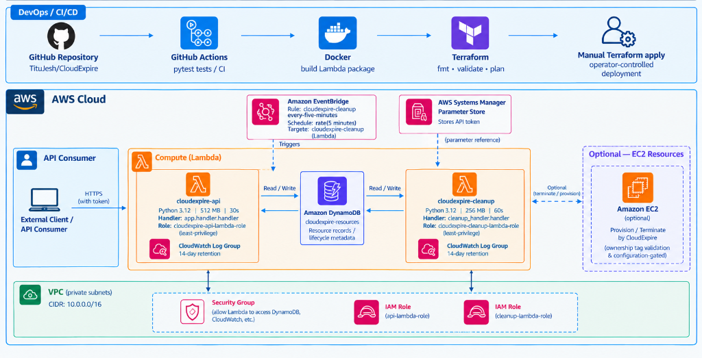
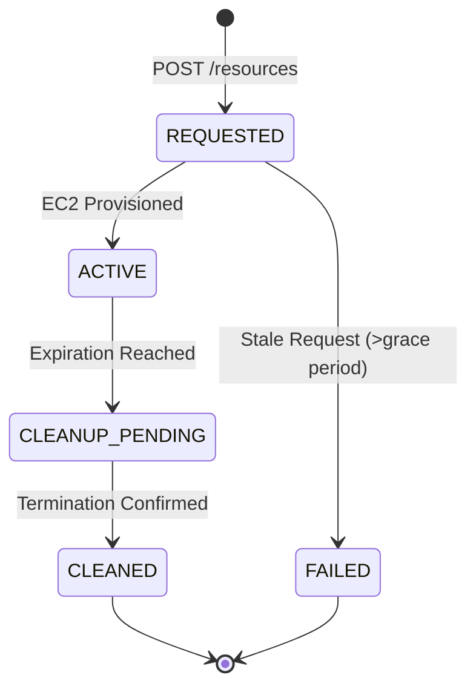

# CloudExpire

<p align="center">
  <strong>Automated AWS Resource Lifecycle Management</strong><br>
  <em>Provision temporary AWS resources. Track their expiry. Clean them up automatically.</em>
</p>

<p align="center">
  <a href="https://github.com/TituJesh/CloudExpire/actions"></a>
  <a href="https://www.python.org/"></a>
  <a href="https://fastapi.tiangolo.com/"></a>
  <a href="https://aws.amazon.com/"></a>
  <a href="https://www.terraform.io/"></a>
  <a href="https://pytest.org/"></a>
</p>

---

## Overview

Temporary cloud environments often outlive their purpose, resulting in unnecessary costs and security risks. **CloudExpire** is a serverless lifecycle management engine that provisions short-lived EC2 instances with configurable TTLs, tracks expiration state in DynamoDB, and terminates expired resources automatically via scheduled AWS Lambda functions.

---

## Key Features

- ⚡ **On-Demand Provisioning** — Request EC2 instances via REST API with configurable TTL (1–24 hours).
- ⏱️ **TTL Tracking** — DynamoDB tracks creation timestamps, expiration windows, and active state.
- 🧹 **Automated Cleanup** — Amazon EventBridge triggers a cleanup Lambda every 5 minutes to terminate expired instances.
- 🛡️ **Safety Guardrails** — Destruction disabled by default (`dry-run`); strictly validates ownership tags (`Project=CloudExpire`) before terminating.
- 🔄 **State Reconciliation** — Recovers stale unprovisioned requests and transitions states through `REQUESTED` ➔ `ACTIVE` ➔ `CLEANUP_PENDING` ➔ `CLEANED` / `FAILED`.
- 🏗️ **Infrastructure as Code** — Complete AWS infrastructure defined and provisioned with Terraform.
- 📊 **Observability** — Structured execution summaries and metrics logged to Amazon CloudWatch.
- 🧪 **Fully Tested** — 24 automated unit and integration tests passing in CI.

---

## Architecture



### Resource Lifecycle



<details>
<summary><strong>AWS Components Breakdown</strong></summary>

| Component | Responsibility |
|---|---|
| **API Gateway** | Public REST interface forwarding to FastAPI Lambda |
| **AWS Lambda (API)** | FastAPI application handling resource requests & auth |
| **Amazon DynamoDB** | Single-table storage for resource metadata, status & TTL |
| **Amazon EventBridge** | Cron rule invoking cleanup every 5 minutes |
| **AWS Lambda (Cleanup)** | Scans expired records, checks EC2 tags & terminates instances |
| **Amazon EC2** | Temporary compute instances launched with ownership tags |
| **SSM Parameter Store** | Secure bearer token storage for API authentication |
| **CloudWatch Logs** | 14-day retained execution logs & operational metrics |

</details>

---

## Tech Stack

| Layer | Technologies |
|---|---|
| **Backend & API** | Python 3.12, FastAPI, Pydantic v2, Uvicorn |
| **Cloud Services** | AWS EC2, DynamoDB, Lambda, EventBridge, API Gateway, SSM, CloudWatch |
| **IaC & Tooling** | Terraform, Docker, Pytest, GitHub Actions |

---

## Account Ownership and Future Enhancements

### Which AWS Account Owns the Allocated Resources?

CloudExpire currently provisions temporary EC2 instances in the AWS account where the application is deployed and authorized to operate. Users can submit resource requests through the API using an authorized bearer token without needing to provide their own AWS credentials.

The API Lambda uses its IAM execution role to provision EC2 instances, while DynamoDB tracks resource metadata and expiration timestamps. A scheduled cleanup Lambda identifies eligible resources and terminates them according to the project's cleanup logic.

**Important:** API authentication controls who can request resources from CloudExpire, while AWS IAM permissions determine which AWS account the application can access. A user's separate AWS account is not automatically used when they submit a request.

### Future Enhancement: Cross-Account Resource Provisioning

A planned enhancement is to support provisioning resources directly within users' own AWS accounts using **AWS IAM cross-account roles and AWS Security Token Service (STS)**.

With this approach, a user would explicitly authorize CloudExpire to assume a dedicated IAM role in their AWS account. CloudExpire could then use temporary, scoped credentials to provision and manage resources within the authorized account, subject to the role's permissions.

Potential improvements include:

- Cross-account EC2 provisioning and lifecycle management.
- Least-privilege IAM roles and temporary credentials.
- Account-specific resource tracking and cleanup.
- Per-user authentication, resource quotas, and usage controls.
- Improved cost visibility and safeguards against unauthorized resource creation.

Cross-account provisioning is a future enhancement and is not part of the current implementation.

---

## Getting Started

### Prerequisites

- Python 3.12+
- AWS CLI & Terraform >= 1.6 (for deployment)

### Local Setup

```bash
# 1. Clone the repository
git clone https://github.com/TituJesh/CloudExpire.git
cd CloudExpire

# 2. Set up virtual environment
python -m venv .venv
source .venv/bin/activate       # Windows: .\.venv\Scripts\Activate.ps1

# 3. Install dependencies
pip install -r requirements.txt

# 4. Start local API
uvicorn app.main:app --reload
```

- **Interactive API Docs:** `http://127.0.0.1:8000/docs`
- **Health Check:** `http://127.0.0.1:8000/health`

### Running Tests

```bash
pytest tests/ -q
# 24 passed
```

---

## API Reference

All `/resources` endpoints require bearer token authentication: `Authorization: Bearer <token>`.

| Method | Endpoint | Auth | Description |
|---|---|:---:|---|
| `GET` | `/health` | Public | Service health check |
| `POST` | `/resources` | Required | Register & provision a temporary resource |
| `GET` | `/resources` | Required | List all tracked resources |
| `GET` | `/resources/{id}` | Required | Get resource details and lifecycle status |

<details>
<summary><strong>Example Request & Response</strong></summary>

**Request (`POST /resources`):**
```json
{
  "name": "dev-sandbox",
  "resource_type": "ec2",
  "ttl_hours": 2,
  "instance_type": "t3.micro"
}
```

**Response (`201 Created`):**
```json
{
  "resource_id": "ce-7d9a1b2c",
  "name": "dev-sandbox",
  "resource_type": "ec2",
  "instance_type": "t3.micro",
  "aws_resource_id": "i-0123456789abcdef0",
  "status": "ACTIVE",
  "created_at": "2026-10-26T12:00:00Z",
  "expires_at": "2026-10-26T14:00:00Z"
}
```

</details>

---

## Safety & Controls

CloudExpire employs strict safeguards to prevent unintended cloud operations:

1. **Dry-Run by Default:** EC2 launch and termination are disabled unless explicitly enabled via environment flags (`CLOUDEXPIRE_ALLOW_EC2_LAUNCH=true`, `CLOUDEXPIRE_ALLOW_EC2_TERMINATION=true`).
2. **Tag Ownership Enforcement:** Cleanup validates `Project=CloudExpire`, `ManagedBy=CloudExpire`, and matching `ResourceId` before issuing termination calls.
3. **Least-Privilege IAM:** Cleanup Lambda execution role restricts `ec2:TerminateInstances` with resource tag conditions.

---

## AWS Deployment

### 1. Provision Infrastructure with Terraform

```bash
cd terraform
terraform init
terraform plan
terraform apply
```

### 2. Package & Deploy Cleanup Lambda

Because Terraform lifecycle rules ignore Lambda code hashes to allow independent CI/CD deployments:

```powershell
# Build package (Linux x86_64 compatible container)
.\scripts\build_lambda_package.ps1

# Update Lambda function code
aws lambda update-function-code `
  --function-name cloudexpire-cleanup `
  --zip-file fileb://lambda/cleanup_lambda.zip `
  --region ap-south-1
```

---

## Project Structure

```text
CloudExpire/
├── app/
│   ├── main.py                     # FastAPI application & endpoints
│   ├── schemas.py                  # Pydantic request/response models
│   ├── repositories/               # In-memory & DynamoDB persistence
│   └── services/                   # EC2 provisioning, TTL expiry & cleanup logic
├── lambda/
│   └── src/cleanup_handler.py      # Scheduled Lambda cleanup entry point
├── scripts/
│   └── build_lambda_package.ps1    # Lambda packaging script
├── terraform/                      # Complete AWS IaC definitions
├── tests/                          # 24 unit & integration test suites
└── .github/workflows/ci.yml        # CI test pipeline
```

---

## Author

**Titu Jeshurun B.**  
*Aspiring Cloud & DevOps Engineer*

- **GitHub:** [@TituJesh](https://github.com/TituJesh)
- **Project:** [CloudExpire](https://github.com/TituJesh/CloudExpire)

<p align="center">
  <sub>Engineered for automated cloud governance and cost optimization.</sub>
</p>
