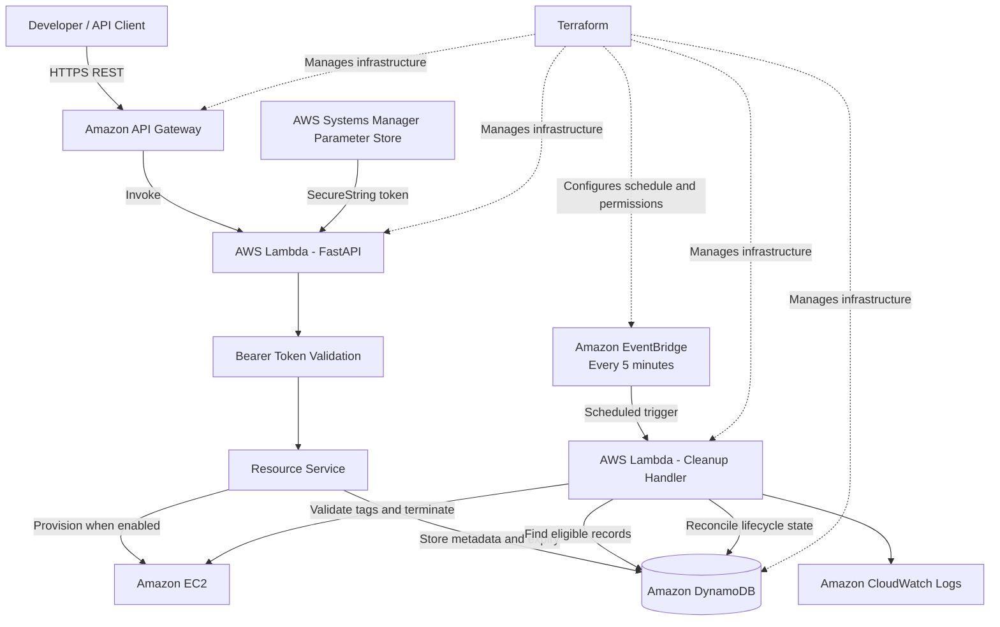
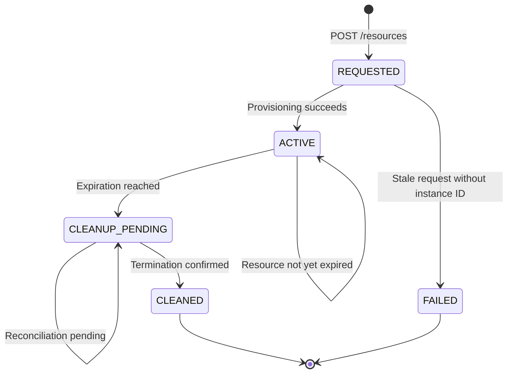

# CloudExpire

<p align="center">
  <strong>Automated AWS Resource Lifecycle Management</strong><br>
  <em>Provision temporary AWS resources. Track their expiry. Clean them up automatically.</em>
</p>

<p align="center">
  <a href="https://github.com/TituJesh/CloudExpire/actions"></a>
  <a href="https://www.python.org/"></a>
  <a href="https://fastapi.tiangolo.com/"></a>
  <a href="https://aws.amazon.com/"></a>
  <a href="https://www.terraform.io/"></a>
  <a href="https://pytest.org/"></a>
</p>

---

## Overview

Temporary cloud environments can outlive their intended purpose, creating unnecessary cloud costs and an expanded security surface.

**CloudExpire** is a Python-based AWS resource lifecycle manager that provisions temporary EC2 instances, tracks their expiration times, and automatically cleans up eligible resources.

A FastAPI application handles resource requests, Amazon DynamoDB stores lifecycle metadata, and a scheduled AWS Lambda cleanup function evaluates expired resources. Amazon EventBridge triggers the cleanup process every five minutes.

The project combines API development, infrastructure as code, serverless automation, automated testing, and resource-level safety controls.

## Key Capabilities

- ⚡ **Temporary EC2 Provisioning** — Request EC2 instances through REST endpoints with a configurable TTL of 1–24 hours.
- ⏱️ **TTL Tracking** — Store creation and expiration timestamps alongside resource metadata in DynamoDB.
- 🧹 **Automated Cleanup** — EventBridge invokes a cleanup Lambda every five minutes to process eligible expired resources.
- 🛡️ **Ownership Validation** — Validate resource ownership tags before performing destructive EC2 operations.
- 🔄 **Lifecycle Reconciliation** — Track resource states, including `REQUESTED`, `ACTIVE`, `CLEANUP_PENDING`, `CLEANED`, and `FAILED`.
- 🩺 **Stale-Request Recovery** — Mark sufficiently old requests without an associated EC2 instance as `FAILED`.
- 📊 **Operational Observability** — Emit structured execution summaries to CloudWatch Logs.
- 🏗️ **Infrastructure as Code** — Define AWS infrastructure using Terraform.
- 🧪 **Automated Testing** — Run unit and integration tests through pytest and GitHub Actions.

## Architecture & Lifecycles


<details>
<summary><strong>System Architecture Flowchart (Mermaid)</strong></summary>



</details>

<details>
<summary><strong>Resource Lifecycle State Machine</strong></summary>



The cleanup process evaluates expiration timestamps rather than relying on DynamoDB TTL deletion. Stale requests without an EC2 instance ID are marked `FAILED` after the configured grace period.

</details>

<details>
<summary><strong>AWS Components</strong></summary>

| Component | Responsibility |
|---|---|
| Amazon API Gateway | Exposes the HTTP API endpoint. |
| AWS Lambda — API | Runs the FastAPI application. |
| Amazon EC2 | Hosts temporary compute resources. |
| Amazon DynamoDB | Persists resource metadata and expiration timestamps. |
| AWS Lambda — Cleanup | Evaluates expired resources and reconciles lifecycle state. |
| Amazon EventBridge | Triggers cleanup every five minutes. |
| AWS Systems Manager Parameter Store | Stores the API bearer token as a SecureString. |
| Amazon CloudWatch | Collects Lambda logs with configured 14-day retention. |
| AWS IAM | Restricts service permissions and eligible resource operations. |
| Terraform | Defines and manages AWS infrastructure. |

**Deployment note:** FastAPI runs locally for development and is also deployed through Amazon API Gateway and AWS Lambda. A separate scheduled Lambda function handles expiry checks and cleanup.

</details>

## Safety & Safeguards

CloudExpire uses multiple safeguards to reduce the risk of unintended resource operations.

1. **Explicit safety flags:** EC2 provisioning and termination require explicit configuration. Local defaults keep destructive actions disabled unless enabled deliberately.
2. **Read-only cleanup mode:** When termination is disabled, the cleanup process can inspect eligible records without issuing EC2 termination calls.
3. **Ownership tag validation:** The cleanup logic validates the expected ownership metadata:
   - `Project = CloudExpire`
   - `ManagedBy = CloudExpire`
   - `ResourceId` matches the registered resource ID.
4. **State-aware handling:** Unexpected or transitional EC2 states are handled without blindly repeating destructive operations.
5. **Restricted IAM permissions:** The cleanup role uses scoped permissions and tag-based conditions for eligible EC2 operations.
6. **Cost controls:** DynamoDB uses on-demand capacity, and CloudWatch log groups have configured retention.
7. **Provisioning constraints:** EC2 launch configuration restricts eligible instance types and uses explicitly configured AMI, subnet, and security group values.

These safeguards reduce risk but do not guarantee that accidental changes or AWS charges are impossible. Review IAM policies, resource tags, network settings, and environment flags before using the project in a new AWS account.

## Getting Started

### Prerequisites

- Python 3.12
- AWS CLI configured with appropriate credentials if using AWS services
- Terraform 1.6 or later
- An AWS account and an appropriate AWS region
- Docker with Python 3.12 support for building the cleanup Lambda package as configured in the project

### Local Setup

```powershell
# Clone the repository
git clone https://github.com/TituJesh/CloudExpire.git
cd CloudExpire

# Create and activate a virtual environment
python -m venv .venv
.\.venv\Scripts\Activate.ps1

# Install dependencies
python -m pip install --upgrade pip
python -m pip install -r requirements.txt

# Run the local API
python -m uvicorn app.main:app --reload
```

Open the interactive API documentation at:

- API docs: http://127.0.0.1:8000/docs
- Health check: http://127.0.0.1:8000/health

The local API can use an in-memory repository for development. Configure DynamoDB and AWS credentials when testing against AWS-backed storage.

### Running Tests

```powershell
python -m pytest -q --import-mode=importlib
```

**Latest local test result:** 24 tests passed. One Starlette deprecation warning was reported; it did not cause the test run to fail.

The tests cover request validation, expiry calculation, repository behavior, EC2 provisioning safeguards, cleanup behavior, and lifecycle state handling.

## API Authentication

The deployed API protects resource endpoints using bearer-token authentication. The health endpoint is available for health checks.

For local development, configure the API token in the environment:

```powershell
$env:CLOUDEXPIRE_API_TOKEN = "<your-local-api-token>"
```

Include the token when calling protected endpoints:

```http
Authorization: Bearer <your-api-token>
```

In the deployed Lambda configuration, the token is retrieved from AWS Systems Manager Parameter Store using a SecureString parameter. The parameter name is configurable through Terraform; the deployed setup uses `/cloudexpire/prod/api-token`.

The Lambda execution role needs permission to read the configured parameter. Do not commit API tokens, AWS credentials, or other secrets to the repository.

## AWS Infrastructure Deployment

> **Warning:** The following configuration can create billable AWS resources and enable real EC2 provisioning. Review the Terraform plan and your AWS configuration before applying changes.

### Environment Variables

The following example uses PowerShell and the existing DynamoDB table.

```powershell
$env:AWS_REGION = "ap-south-1"
$env:CLOUDEXPIRE_STORAGE = "dynamodb"
$env:DYNAMODB_TABLE_NAME = "cloudexpire-resources"

$env:CLOUDEXPIRE_PROVISION_EC2 = "true"
$env:CLOUDEXPIRE_ALLOW_EC2_LAUNCH = "true"

$env:CLOUDEXPIRE_AMI_ID = "<your-ami-id>"
$env:CLOUDEXPIRE_SUBNET_ID = "<your-subnet-id>"
$env:CLOUDEXPIRE_SECURITY_GROUP_ID = "<your-security-group-id>"
```

The two provisioning flags serve related but distinct purposes: `CLOUDEXPIRE_PROVISION_EC2` controls the resource service's provisioning path, while `CLOUDEXPIRE_ALLOW_EC2_LAUNCH` is checked by the EC2 launch service.

**For local development, do not enable real provisioning unless you intentionally want to create AWS resources.** Use a suitable test configuration and least-privilege AWS credentials.

### Terraform

From the repository root:

```powershell
cd terraform

terraform init
terraform fmt -check
terraform validate
terraform plan
```

Review the plan before applying:

```powershell
terraform apply
```

Use the Terraform outputs to obtain the deployed API URL and configured SSM parameter name.

The exact API deployment artifact and variable values must match the current Terraform configuration. Do not assume that applying Terraform automatically packages every application source change.

### Cleanup Lambda Packaging and Code Deployment

The cleanup Lambda uses Python 3.12. Its dependencies must be packaged for a compatible Lambda runtime and architecture. Use the repository's packaging process and build the artifact in the configured Python 3.12 environment.

The Terraform configuration has a lifecycle rule that ignores changes to the cleanup Lambda's `filename` and `source_code_hash`. **Running `terraform apply` alone will not update the deployed cleanup Lambda code.**

When cleanup code changes:

1. Build the deployment package using the repository's packaging process.
2. Confirm the ZIP contains the handler and its required dependencies.
3. Deploy the newly built ZIP to the `cloudexpire-cleanup` Lambda using the appropriate AWS CLI deployment command or deployment process.
4. Verify the Lambda configuration and review its CloudWatch logs after invocation.

For an existing ZIP artifact, the AWS CLI update operation has this form:

```powershell
aws lambda update-function-code `
  --function-name cloudexpire-cleanup `
  --zip-file fileb://<path-to-cleanup-lambda.zip> `
  --region ap-south-1
```

Replace the placeholder with the actual path of the ZIP generated by your packaging process. Do not run this command until the package has been built and reviewed.

The cleanup Lambda's destructive-action flag, `CLOUDEXPIRE_ALLOW_EC2_TERMINATION`, should only be enabled when you intend to permit termination and have verified the IAM restrictions and ownership checks.

## API Reference

| Method | Endpoint | Description |
|---|---|---|
| `GET` | `/health` | Health check |
| `POST` | `/resources` | Register and optionally provision a temporary resource |
| `GET` | `/resources` | List tracked resources |
| `GET` | `/resources/{id}` | Retrieve a resource by ID |

Resource endpoints require bearer-token authentication in the deployed API.

<details>
<summary><strong>Example Resource Request and Response</strong></summary>

**Request — `POST /resources`**

```json
{
  "name": "cloudexpire-demo",
  "resource_type": "ec2",
  "ttl_hours": 1,
  "instance_type": "t3.micro"
}
```

**Illustrative response — `201 Created`**

```json
{
  "resource_id": "ce-example-resource-id",
  "name": "cloudexpire-demo",
  "resource_type": "ec2",
  "instance_type": "t3.micro",
  "aws_resource_id": "i-0123456789abcdef0",
  "status": "ACTIVE",
  "created_at": "2026-10-22T12:00:00Z",
  "expires_at": "2026-10-22T13:00:00Z"
}
```

The IDs and timestamps above are illustrative examples, not identifiers from a real request.

</details>

## Verification & End-to-End Validation

| Verification | Result | Details |
|---|---|---|
| Python unit and integration tests | ✅ Passed | 24 tests passed locally |
| Terraform formatting and validation | ✅ Passed | Formatting and configuration validation checked |
| DynamoDB persistence | ✅ Verified | Resource metadata and lifecycle state persisted |
| Scheduled EventBridge trigger | ✅ Verified | Five-minute scheduled invocations observed |
| CloudWatch observability | ✅ Verified | Structured cleanup execution summaries logged |
| EC2 end-to-end cleanup | ✅ Verified | Test instance terminated and lifecycle state reconciled |

### End-to-End EC2 Cleanup Test

A real EC2 instance was launched and tagged, with its resource metadata stored in DynamoDB. To test the cleanup path without waiting for the natural expiry time, the recorded `expires_at` timestamp was deliberately backdated.

The cleanup Lambda then detected the eligible record, validated the ownership tags, initiated EC2 termination, and reconciled the resource state to `CLEANED`.

**This validates the cleanup workflow using simulated expiration; it does not mean the instance was allowed to expire naturally.**

The test exercised the AWS integration path, including actual EC2 termination. AWS resources can incur charges, so verify that test instances and other temporary resources have been cleaned up.

## Project Structure

<details>
<summary><strong>View Repository Structure</strong></summary>

```text
CloudExpire/
├── .github/
│   └── workflows/
│       └── ci.yml                  # GitHub Actions test workflow
├── app/
│   ├── main.py                     # FastAPI application and routes
│   ├── schemas.py                  # Request and response models
│   ├── repositories/
│   │   └── resource_repository.py  # In-memory and DynamoDB persistence
│   └── services/
│       ├── cleanup_service.py      # Cleanup and lifecycle reconciliation
│       ├── ec2_service.py          # EC2 provisioning and tagging
│       ├── expiry.py               # TTL and expiry calculations
│       └── resource_service.py     # Resource lifecycle orchestration
├── docs/
│   └── images/
│       └── architecture-diagram.png # Architecture and CI/CD diagram
├── lambda/
│   ├── cleanup-requirements.txt    # Cleanup Lambda dependencies
│   └── src/
│       └── cleanup_handler.py      # Cleanup Lambda entry point
├── scripts/
│   └── build_lambda_package.ps1    # Lambda packaging script
├── terraform/
│   └── main.tf                     # AWS infrastructure configuration
├── tests/
│   ├── test_cleanup_execution.py
│   ├── test_cleanup_service.py
│   ├── test_ec2_service.py
│   └── ...
├── requirements.txt                # Application dependencies
└── README.md
```

</details>

## Author

**Titu Jeshurun B.**  
Aspiring Cloud & DevOps Engineer

- **GitHub:** [@TituJesh](https://github.com/TituJesh)
- **Repository:** [CloudExpire](https://github.com/TituJesh/CloudExpire)

<p align="center">
  <sub>Built with a focus on cloud automation, cost optimization, and safe engineering practices.</sub>
</p>
